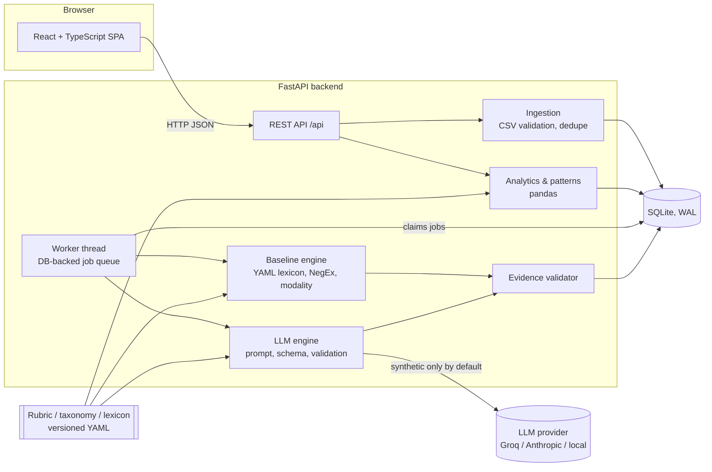

# SafetyLens — Project Document

**AI/NLP engine to detect Serious Injury & Fatality (SIF) precursors in unsafe-act / unsafe-condition and near-miss reports**
Prototype for Oil India Limited, Problem Statement 26165.

> **Status: hackathon prototype.** The SIF rubric is a *proposal* awaiting alignment with OIL's own definition. All bundled
> data is synthetic, and every evaluation number in this document is illustrative. Nothing here has been validated on real OIL
> reports.

---

## Contents
1. [Summary](#1-summary)
2. [The problem](#2-the-problem)
3. [What SafetyLens does](#3-what-safetylens-does)
4. [How a report is assessed](#4-how-a-report-is-assessed)
5. [Architecture](#5-architecture)
6. [Analysis engines](#6-analysis-engines)
7. [Data model](#7-data-model)
8. [Analytics and patterns](#8-analytics-and-patterns)
9. [User interface](#9-user-interface)
10. [Security, privacy and governance](#10-security-privacy-and-governance)
11. [Synthetic data and evaluation](#11-synthetic-data-and-evaluation)
12. [Running the project](#12-running-the-project)
13. [Testing](#13-testing)
14. [Repository layout](#14-repository-layout)
15. [API reference](#15-api-reference)
16. [Limitations](#16-limitations)
17. [Roadmap to operational use](#17-roadmap-to-operational-use)
18. [Glossary](#18-glossary)

---

## 1. Summary

Oil and gas operators collect thousands of unsafe-act, unsafe-condition and near-miss reports. Most describe low-severity
events, but a minority describe situations that could have killed someone: a person under a suspended load, maintenance on
equipment that was not isolated, work at height without fall protection. These **SIF precursors** are the reports that matter
most, and they are currently found by manual, periodic review.

SafetyLens reads each free-text report and:

- **assesses SIF potential** in three classes: `SIF_POTENTIAL`, `NON_SIF_POTENTIAL`, or `INSUFFICIENT_INFORMATION` (an explicit
  abstention that lists the facts needed);
- **tags the relevant IOGP Life-Saving Rules** (LSR-01 … LSR-09), multi-label, each with a status of breach, control or unclear;
- **extracts the precursor facts** (activity, harm mechanism, exposure, barriers that failed or held, potential consequence)
  and ties every claim to an **exact quote** from the original text;
- puts a **safety professional in control**: every assessment can be confirmed or corrected, and the history is append-only;
- shows **where to focus**: sites and activities ranked by reported SIF-precursor density, recurring precursor patterns, and a
  triage order for the review queue.

It runs fully offline with a transparent rule-based engine. An LLM engine (Groq, Anthropic or any OpenAI-compatible endpoint,
including local models) can be enabled, with strict output validation and a data-policy guard.

## 2. The problem

From Problem Statement 26165:

- UA/UC observations, near-miss and incident reports are **reviewed manually at monthly or quarterly intervals**, so a serious
  precursor can sit unread for weeks.
- Low-severity and high-severity events **do not share the same causes**. Over 15 years, non-fatal accidents in the US fell 51%
  while fatalities fell only 25.5% (DEKRA; Martin & Black, 2015). Reducing minor injuries does not automatically reduce fatalities.
- Only around **20–25% of reports carry genuine SIF potential** (EEI SIF precursor model; VelocityEHS, 2024). Finding them by hand
  in a large volume of narratives is slow and inconsistent.

**What is needed:** a consistent, explainable way to surface SIF-potential reports as they arrive, link them to Life-Saving
Rules, and show recurring patterns by site, activity and failed barrier, without replacing the judgement of HSE professionals.

### Design goals
| Goal | How SafetyLens addresses it |
|---|---|
| Explainable | Every assessment cites exact evidence spans from the report; no black-box scores or confidence percentages |
| Safe failure | Abstains rather than guesses; engine failures are stored as `PROCESSING_ERROR`, never as "not SIF" |
| Human in control | Review workflow with an append-only audit trail; model and reviewer views kept separate |
| Honest analytics | Numerators and denominators always shown; small samples are flagged and not ranked |
| Works offline | Deterministic baseline engine needs no network or API key |
| Configurable | Rubric, taxonomy and lexicon are versioned YAML files; every analysis records the versions it used |

## 3. What SafetyLens does

| Area | Capability |
|---|---|
| **Ingestion** | CSV upload with a validation preview before anything is stored: column check, rejected rows, exact duplicates, probable near-duplicates, unparseable dates. Downloadable template. Manual single-report entry. Idempotent re-import. Synthetic vs operational provenance. |
| **Processing** | Background worker backed by the database. Progress is persistent, so refreshing the page never restarts work. Failed rows are listed with a retry button. Jobs interrupted by a restart are marked *interrupted* and resumed explicitly. |
| **Assessment** | Three-class SIF assessment with rationale, event modality (actual / prevented / hypothetical / historical) and a qualitative evidence-sufficiency level. |
| **Life-Saving Rules** | Multi-label tagging of LSR-01…09 with relevance (primary/secondary), status (breach/control/unclear), explanation and evidence. Hazards outside the rules are listed separately, never forced into a rule. |
| **Evidence** | Every quote is verified against the original text; offsets are repaired if needed and unfound quotes are removed. Highlights in the UI are exact character spans. |
| **Review** | Confirm or correct the assessment and rule tags with notes and reviewer name. Append-only history. Re-analysis creates a new analysis version; old versions are kept. |
| **Analytics** | Reported SIF-precursor density with n/N and a 95% Wilson range; sites and activities ranked; a *Where to focus* list (site × activity); monthly trend; rule distribution; barrier-failure frequencies; review backlog; model-assessed vs reviewer-confirmed views. |
| **Patterns** | Recurring precursor patterns by deterministic grouping: activity → mechanism → failed barrier, or by site. Every pattern links to its supporting reports. |
| **Triage** | Reports sortable by triage priority: unreviewed SIF first, then abstentions. |
| **Export** | CSV of the filtered reports with analysis, versions and latest review (formula-injection safe). |
| **Evaluation** | Reproducible runner with SIF precision/recall, confusion matrix, abstention and coverage, rule-tagging F1, evidence validity, latency and failures. Results appear on the Evaluation page. |

### Users
- **Field supervisors / reporters** submit reports (via CSV export from the existing system or manual entry).
- **HSE professionals** triage the queue, review and correct assessments, and investigate patterns.
- **Site and HSE management** use the Overview to see where SIF precursors concentrate.

## 4. How a report is assessed

### The rubric (`rubric-v1.0.0-proposed`)
A report is **SIF_POTENTIAL** only when all three pillars are supported by quotes from the report:

1. **Harm mechanism** — a credible serious or fatal mechanism: fall from height, suspended load, dropped object, hazardous
   energy, electrical, hazardous atmosphere (e.g. H₂S), fire/explosion, vehicle, caught-between, pressure release.
2. **Exposure** — a person was actually in, or credibly near, the harm zone.
3. **Failed barrier** — a critical control is stated (or demonstrated by the event) to be failed, absent or ineffective.

**NON_SIF_POTENTIAL** needs sufficient explicit context: only minor mechanisms, exposure stated absent or prevented, critical
controls stated effective, or only a historical reference.

**INSUFFICIENT_INFORMATION** is an abstention, not a negative. It is used when a pillar is missing or the report contradicts
itself, and always comes with the facts a supervisor should add.

### Principles
- **Potential, not outcome.** A no-injury near miss beside a suspended load can be SIF potential; a minor injury does not cap it.
- **Silence is not failure.** A barrier is never assumed absent because it is not mentioned.
- **Modality matters.** Hypothetical ("could have…") and historical (toolbox talk) clauses do not count as actual exposure or failure.
- **Rules are independent of SIF potential.** An expired permit for ground-level painting is an LSR-08 breach without SIF potential.
- **Nothing is invented.** Unknown locations, equipment, exposure or barriers stay unknown.
- **Report text is data.** Instruction-like text inside a report ("ignore previous instructions…") is flagged and has no effect.

### Worked examples (synthetic)
| Report (abridged) | Result | Why |
|---|---|---|
| A fitter walked under the suspended load to guide it by hand; load about 4 m above him. No injury. | **SIF potential**, LSR-06 breach, LSR-07 | Suspended-load mechanism, actual exposure, exclusion zone ineffective |
| Frayed sling found at inspection and quarantined before the lift. | **Non-SIF** | Same mechanism, but exposure prevented and the inspection barrier worked |
| Pump started unexpectedly while a technician was cleaning the impeller. | **SIF potential**, LSR-04 breach | Hazardous energy, actual exposure, isolation failed |
| Isolation verified with a try-start before cleaning. | **Non-SIF**, LSR-04 control | Control stated effective |
| "Unsafe condition observed near tank area." | **Insufficient information** | No mechanism, exposure or barrier stated; asks for those facts |
| Permit expired; crew kept painting a ground-level handrail. | LSR-08 breach, **no SIF mechanism** | A rule breach is not automatically SIF potential |

## 5. Architecture



### Request flow
1. **Upload** — the CSV is parsed and validated; the preview endpoint writes nothing.
2. **Commit** — reports are stored with a text hash and provenance; one analysis job per report is queued; the batch records the
   engine chosen.
3. **Worker** — a single in-process thread claims jobs atomically, runs the engine, validates the output, and stores the analysis,
   facts, rule tags and evidence spans in one transaction, with a heartbeat. Progress survives refreshes and restarts.
4. **Review** — reviewers add append-only review records linked to the specific analysis version they reviewed.
5. **Analytics** — overview, rankings and patterns are computed on demand from the stored analyses (or latest reviews), with the
   same filters used everywhere.

### Technology
| Layer | Choice |
|---|---|
| Frontend | React 19, TypeScript, Vite, React Router 7, TanStack Query, Recharts, Tailwind CSS v4, bundled Inter + Fraunces fonts |
| Backend | Python 3.11+, FastAPI, SQLAlchemy 2, pydantic / pydantic-settings, pandas, rapidfuzz, httpx, Anthropic SDK |
| Storage | SQLite in WAL mode (file in `data/db/` or a Docker volume) |
| Deployment | Docker Compose: API container + nginx serving the built UI on port 8080 |

## 6. Analysis engines

Both engines produce the same validated output contract (`AnalysisOutput`), so the UI, analytics and evaluation treat them
identically. Each analysis stores the engine, model, prompt, rubric and taxonomy versions that produced it.

### 6.1 Rule-based baseline (default)
A deterministic, transparent engine; **not a trained model**.
- Splits the narrative into clauses with character offsets.
- Matches a versioned YAML lexicon (`baseline_lexicon_v1.yaml`) for activities, harm mechanisms, exposure, barriers and rule cues.
- **NegEx-style negation** ("no harness" = failed barrier; "no issues with the harness" ≠ failure).
- **Clause modality**: actual, prevented ("stopped before…", "quarantined"), hypothetical ("could", "if"), historical ("last year",
  "toolbox talk").
- Barrier-implies-mechanism mapping (e.g. a failed exclusion zone implies line-of-fire exposure).
- Applies the rubric literally and abstains with a facts-needed list when a pillar lacks evidence.
- Runs in about 1 ms per report, fully offline.

### 6.2 LLM adapter (optional)
Provider-neutral: Anthropic via the official SDK, or any OpenAI-compatible endpoint (Groq, Ollama, vLLM, LM Studio).

- **Prompt** (`prompt-v1.2.0`, default) contains the rubric, taxonomy and a decision procedure; never any evaluation labels or
  examples derived from them. The report is passed inside `<report>` delimiters as untrusted data. The model has no tools.
- **Structured output**: a strict JSON schema with enum-constrained rule IDs and categories (falls back to JSON mode where the
  provider rejects schemas).
- **Server-side validation**: every quote must be an exact substring of the report (offsets repaired, unfound quotes removed). An
  `SIF_POTENTIAL` answer must have valid evidence for mechanism, exposure and a failed critical barrier.
- **Bounded repair**: invalid output triggers an append-only repair turn showing the model the validator's findings; after the
  retry budget, the report is stored as `PROCESSING_ERROR`. **There is no silent fallback to the baseline and no default to non-SIF.**
- **Rate limits**: short `retry-after` waits are honoured; long quota exhaustion fails fast with a clean message (no account
  identifiers leaked).
- **Prompt versioning**: `LLM_PROMPT_VERSION` selects `prompt-v1.1.0` or `prompt-v1.2.0` for A/B evaluation. v1.2 was tuned only
  on the dev split (see §11).

## 7. Data model

SQLite tables (SQLAlchemy models in `backend/app/models.py`):

| Table | Purpose |
|---|---|
| `batches` | One per import: filename, file hash (idempotency), source type, engine, status, counts |
| `reports` | Original text (never modified), normalised text hash, site / date / type (null = unknown), provenance, duplicate links |
| `import_row_issues` | Per-row validation problems kept with the batch |
| `analysis_jobs` | Queue: status, attempts, last error, heartbeat |
| `analyses` | Versioned analyses (`is_current` pointer): engine, model, prompt / rubric / taxonomy versions, status, assessment, rationale, modality, sufficiency, raw provider output, latency |
| `extracted_facts` | Activity, hazards, exposure, barriers (failed / effective / unknown, critical flag), consequence, missing information |
| `rule_tags` | LSR tags with relevance, status, explanation |
| `evidence_spans` | Exact character spans linked to the fact or tag they support |
| `reviews` | **Append-only** confirm/correct decisions with reviewer, time, assessment, rule tags and notes |
| `eval_reference_labels`, `eval_runs` | Evaluation only; analysis code never reads them (enforced by a test) |

## 8. Analytics and patterns

- **Reported SIF-precursor density** = SIF_POTENTIAL ÷ (SIF_POTENTIAL + NON_SIF_POTENTIAL). Always shown as n/N with a 95% Wilson
  interval. It is report-based and depends on reporting culture; it is **not** an exposure-adjusted risk rate.
- **Abstentions** (`INSUFFICIENT_INFORMATION`) are never in the denominator; processing failures and pending jobs are shown separately.
- **Ranking**: sites and activities are ranked by density, SIF count or volume. Groups with fewer than 10 determinate reports, or an
  unknown site/activity, are listed but not ranked.
- **Where to focus**: site × activity combinations with SIF-flagged reports, with their most frequent failed barriers and rules.
- **Views**: *model-assessed* uses each report's current analysis; *reviewer-confirmed* uses the latest review, and unreviewed
  reports are counted as backlog, never imputed.
- **Duplicates**: exact duplicates are never imported; probable near-duplicates (similarity ≥ 92) are imported, flagged and can be
  excluded with a toggle.
- **Patterns**: deterministic grouping of normalised categories — activity → mechanism → failed barrier, site → activity → failed
  barrier, or site → mechanism → failed barrier. Each pattern lists its supporting reports.
- **Filters** (date range, site, activity, data source, view, near-duplicates) live in the URL and apply identically to every card,
  table, chart, pattern list and export.

## 9. User interface

A porcelain blue-and-white theme inspired by engraved line art, with a matching "night porcelain" dark mode. The landing page
features a procedurally drawn engraved landscape of an Assam oilfield (hills, river, tea garden, derrick, tanks, pipeline).
SafetyLens uses its own lens mark; the official Oil India logo is not reproduced.

| Screen | Purpose |
|---|---|
| **Landing** (`/`) | The problem, live stats from this installation, how it works, the three classes, the nine rules, governance |
| **Overview** | KPIs with n/N, monthly trend, review backlog, *Where to focus*, ranked sites and activities, rule distribution, barrier failures |
| **Upload & Analyse** | Drag-and-drop CSV with validation preview, engine choice, live batch progress, retry/resume, manual entry |
| **Reports** | Search, filter and sort (including triage order) all reports; CSV export |
| **Report detail** | Original text with colour-coded evidence highlights linked to each fact and rule tag; assessment card; analysis versions and re-analysis; review form and history |
| **Patterns** | Recurring precursor patterns with grouping options and linked reports |
| **Evaluation** | Stored evaluation runs: metrics, confusion matrix, per-rule scores, under a "synthetic, illustrative" banner |
| **Method & Taxonomy** | Rubric, principles, Life-Saving Rules with sources, and versions |

Motion: the landing landscape draws itself in layers (with a drifting river, a blinking derrick beacon and a flickering flare),
sections reveal on scroll, figures count up, dashboard cards and density bars animate in, and the theme toggle cross-fades.

Accessibility: assessment states always combine colour, icon and text; focus rings on all controls; every animation is
disabled when the operating system's reduce-motion setting is on; layouts work at phone width.

## 10. Security, privacy and governance

- **Secrets** are read only by the backend (`LLM_API_KEY` or `LLM_API_KEY_FILE`, or a Docker secret). They are never returned by any
  API, logged, or included in the browser bundle. `key.txt`, `.env` and `*.key` are git-ignored and excluded from Docker images.
- **External data policy**: with `LLM_DATA_POLICY=synthetic_only` (default), a non-local LLM endpoint may only receive reports
  labelled synthetic. Real reports go to an external provider only after an explicit `LLM_DATA_POLICY=all`. Local endpoints (e.g.
  Ollama) are always allowed. Blocked jobs fail visibly; they never fall back silently.
- **Prompt injection**: report text is delimited as untrusted data; the model has no tools; output is schema-constrained and
  re-validated; instruction-like text is flagged in the UI.
- **Auditability**: original text is never modified; analyses are versioned; reviews are append-only; every analysis records the
  versions that produced it.
- **CSV export** is protected against spreadsheet formula injection.
- **No authentication yet**: reviewer identity is a typed name (see Limitations).

## 11. Synthetic data and evaluation

### Dataset
`backend/seed/generate_synthetic.py --seed 42` reproduces, byte for byte, **278 synthetic reports in 56 scenario groups**
(86 SIF, 162 non-SIF, 30 insufficient by reference label; ≈31% SIF). They cover all nine rules, other hazards, everyday
low-severity observations, contrast pairs, vague narratives, negation and effective controls, and prompt-injection text. Sites are
fictional ("Synthetic Rig R-7"). The split is **by scenario group** (dev 181 / test 97), so paraphrases never straddle dev and test.
Reference labels live in a separate file that application code never reads.

### Results (synthetic, illustrative only)
**Baseline, full test split (97 reports):** SIF precision 1.00, end-to-end recall 0.82, coverage 0.67, **0 SIF cases missed as
non-SIF**, rule micro-F1 0.91, 100% evidence-span validity.

**Baseline vs LLM on a stratified 39-report test sample** (LLM: `openai/gpt-oss-20b` on Groq, prompt v1.1):

| Metric | Baseline | LLM |
|---|---|---|
| SIF precision | 1.00 | 1.00 |
| SIF recall (end-to-end) | 0.83 | 0.75 |
| SIF missed as non-SIF | 0 | 0 |
| Coverage | 0.69 | 0.44 |
| Rule micro P / R / F1 | 0.94 / 0.97 / 0.96 | 1.00 / 0.56 / 0.72 |
| Evidence validity | 100% | 100% |

Both engines are safe in the direction that matters (no SIF report called non-SIF, no false SIF flags). The LLM with prompt v1.1
abstained too often on minor reports and under-tagged rules.

**Prompt tuning (v1.1 → v1.2), dev split only:** every change came from dev-split errors. On the 22 dev reports answered before the
free-tier quota ran out, wrong rule tags fell from 17 to 2 and all v1.1 assessment errors examined were fixed (11 of 11 SIF captured).
The like-for-like test re-run with v1.2 is pending (Groq daily quota). Full details: [EVALUATION.md](EVALUATION.md).

**Why these numbers are optimistic:** templated paraphrases are more regular than real reports; labels are author-assigned against
the authors' own rubric; the baseline lexicon was written alongside the generator; per-rule sample sizes are small.

## 12. Running the project

### Local (no API key needed)
```bash
# Backend
cd backend
python -m venv .venv
.venv/Scripts/python -m pip install -r requirements.txt     # macOS/Linux: .venv/bin/python
.venv/Scripts/python -m uvicorn app.main:app --port 8000

# Frontend (second terminal)
cd frontend
npm install
npm run dev                                                 # http://localhost:5173
```

### Docker
```bash
docker compose up --build                                                     # baseline only
docker compose -f docker-compose.yml -f docker-compose.llm.yml up --build     # with the LLM; key from ./key.txt
```
Open http://localhost:8080. Data persists in the `safetylens-db` volume; `docker compose down -v` wipes it.

### Enabling the LLM (Groq example, in `.env`)
```
ANALYSIS_ENGINE=llm
LLM_PROVIDER=openai_compatible
LLM_BASE_URL=https://api.groq.com/openai/v1
LLM_MODEL=openai/gpt-oss-120b
LLM_API_KEY_FILE=key.txt
LLM_EXTRA_BODY={"reasoning_effort": "low"}
LLM_DATA_POLICY=synthetic_only
```
Groq's free tier allows about 200k tokens per model per day (~45 reports). Use the baseline for bulk imports and the LLM for
individual re-analysis, or a paid tier / local model for volume. All settings are listed in the [README](../README.md).

## 13. Testing

`cd backend && .venv/Scripts/python -m pytest` — **48 tests** covering CSV validation and duplicates, negation and effective
controls, modality, invalid or unsupported LLM output, exact evidence validation and offset repair, multi-label tagging, failed
analyses never becoming non-SIF, append-only review history, analytics denominators, intervals and filters, ranking and focus
areas, location patterns and triage sort, evaluation-data separation, the external-data policy, key-file loading, rate-limit
handling without leaking identifiers, secrets never exposed by the API, CSV export and restart recovery.

Evaluation: `python -m eval.run_eval --engine baseline|llm --split dev|test [--per-group N]` (LLM runs are checkpointed and resumable).

## 14. Repository layout
```
backend/
  app/
    main.py, config.py, db.py, models.py, worker.py
    knowledge/     rubric_v1.yaml, taxonomy_v1.yaml, baseline_lexicon_v1.yaml, loader.py
    analysis/      baseline.py, text_utils.py, validation.py, registry.py
      llm/         prompt.py, engine.py, anthropic_provider.py, openai_compatible_provider.py
    ingestion/     csv_import.py
    services/      imports, persist, query, analytics, patterns, export, reviews
    api/           imports, batches, reports, analytics (REST routes)
    schemas/       analysis output contract
  seed/generate_synthetic.py
  eval/run_eval.py, eval/results/
  tests/
frontend/src/
  pages/           Landing, Overview, Upload, Reports, ReportDetail, Patterns, Evaluation, Method
  components/      Layout, Brand, EngravedLandscape, FilterBar, Ranking, EvidenceText, charts, ui
  lib/             filters, queries, theme, format
data/              synthetic/ (reports + separate reference labels), sample_template.csv, sample_messy.csv
docs/              PROJECT.md, DEMO.md, RUBRIC.md, EVALUATION.md
deploy/            nginx config
docker-compose.yml, docker-compose.llm.yml, .env.example
```

## 15. API reference
All routes are under `/api`; interactive docs at `/docs` on the API server.

| Method & path | Purpose |
|---|---|
| `GET /meta` | Engines, versions, rubric/taxonomy, data policy (no secrets) |
| `GET /filters/options` | Sites, activities, date range for filters |
| `GET /imports/template.csv`, `GET /imports/samples[/{name}]` | Template and demo files |
| `POST /imports/preview` | Validate a CSV without writing |
| `POST /imports/commit` | Import and queue analysis |
| `POST /reports` | Manual single report |
| `GET /batches`, `GET /batches/{id}` | Batch list and progress |
| `POST /batches/{id}/resume`, `POST /batches/{id}/retry-failed` | Recovery |
| `GET /reports` | Search, filter, sort (incl. `sort=triage`), paginate |
| `GET /reports/{id}`, `GET /analyses/{id}` | Report with current analysis, evidence and versions |
| `POST /reports/{id}/reanalyse` | New analysis version with a chosen engine |
| `GET/POST /reports/{id}/reviews` | Review history / add a review |
| `GET /analytics/overview` | KPIs, trend, rankings, focus areas, rules, barriers, backlog |
| `GET /patterns?group_by=…` | Recurring patterns |
| `GET /export/reports.csv` | Filtered export |
| `GET /eval/runs`, `GET /eval/runs/{id}` | Stored evaluation results |

## 16. Limitations
- **Rubric and labels are not validated.** The rubric is a proposal; synthetic labels are author-assigned.
- **The baseline is pattern matching.** It abstains on unseen wording rather than guessing, and its synthetic scores are optimistic.
- **LLM throughput on the Groq free tier is low** (~45 reports per model per day); quota errors are stored as visible processing errors.
- **No authentication or roles**; single-process SQLite worker — fine for a prototype, not for concurrent multi-user production.
- **Patterns use exact category matches**; semantic clustering is not implemented.
- **English only**; real reports may contain local languages, abbreviations and typos not represented in the synthetic data.

## 17. Roadmap to operational use
1. **Align the rubric** with OIL's SIF definition and HSE experts; version it as `rubric_v2`.
2. **Build a real evaluation set**: an independently labelled, anonymised sample of OIL reports with inter-rater agreement; run it
   through the same runner (`--dataset`).
3. **Choose the deployment model** for real data: an on-premise or private-cloud LLM, or an approved provider under
   `LLM_DATA_POLICY=all` with the necessary agreements.
4. **Integrate** with the existing reporting system (scheduled export or API) so reports are assessed as they arrive.
5. **Add SSO and roles** (reporter, reviewer, manager) and move to PostgreSQL with a separate worker for scale.
6. **Close the loop**: use reviewer corrections to refine the lexicon/prompt, track agreement over time, and alert on new SIF reports.
7. **Extend language coverage** (Hindi/Assamese terms, abbreviations) and add semantic pattern clustering.

## 18. Glossary
| Term | Meaning |
|---|---|
| **SIF** | Serious Injury or Fatality |
| **SIF precursor** | A situation with a credible serious/fatal mechanism, exposure, and a failed or absent critical control |
| **UA / UC** | Unsafe act / unsafe condition observation |
| **LSR** | IOGP Life-Saving Rule (LSR-01 Bypassing Safety Controls … LSR-09 Working at Height) |
| **Barrier** | A control that prevents harm (isolation, exclusion zone, fall protection, gas testing, permit, …) |
| **Abstention** | `INSUFFICIENT_INFORMATION`: the engine declines to decide and lists the facts needed |
| **Density** | SIF reports ÷ determinate reports in a group; report-based, not exposure-adjusted |
| **Determinate** | A report assessed as SIF or non-SIF (not an abstention, error or pending) |
| **Event modality** | Whether a clause is actual, prevented, hypothetical or historical |

Taxonomy sources: IOGP Life-Saving Rules — https://www.iogp.org/workstreams/safety/safety/life-savingrules/ (rule IDs and labels
only; scope notes are SafetyLens paraphrases).
